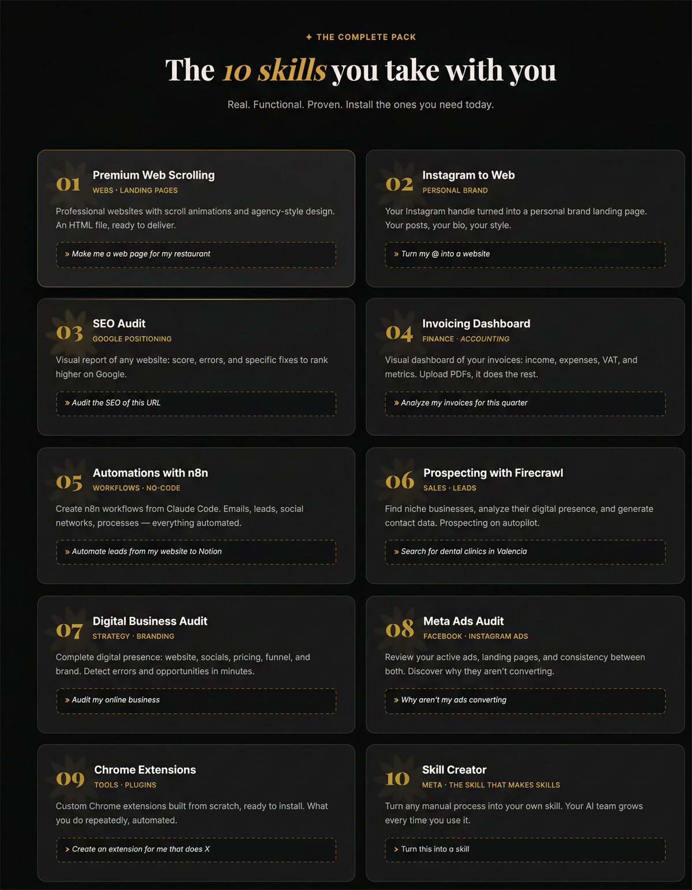
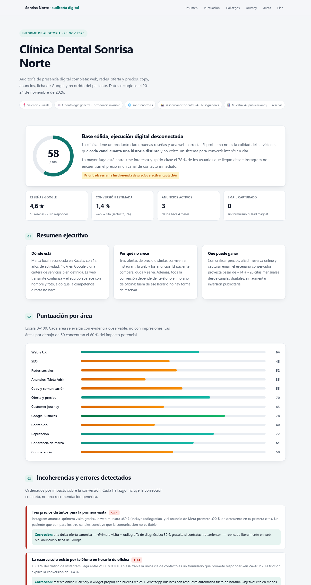
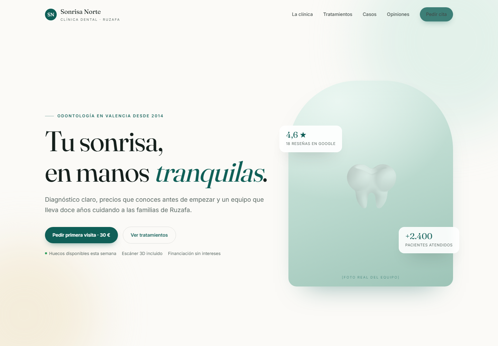

# Claude Skill Factory ES

**Ten native Claude Code skill kits, written in Spanish, that produce real deliverables: landing pages, audit reports, invoicing dashboards, Chrome extensions, n8n workflows and more.**

[](./LICENSE)
[](https://docs.claude.com/en/docs/claude-code)
[](#a-gap-in-the-ecosystem)
[](#the-kits)

---

## A gap in the ecosystem

Claude Code's skill ecosystem is growing fast, but it is almost entirely English-first. A Spanish-speaking developer, agency or small business owner can read the documentation, yet the working layer — the prompts, the domain vocabulary, the deliverables a client actually receives — is still built in English and then translated by hand, badly, at the end.

That matters for three practical reasons:

1. **Skills are prompts, and prompts are language-shaped.** Trigger phrases, tone rules and domain jargon ("auditoría", "factura", "prospección") do not map one-to-one. A translated skill loses the trigger surface that makes it reliable.
2. **Deliverables are client-facing.** An audit report or a landing page produced for a Spanish business has to be written in Spanish, with Spanish pricing conventions, legal disclaimers and tax vocabulary (IVA, CIF, autónomo).
3. **The Spanish-speaking market is large and underserved.** More than 590 million speakers, a growing freelance and agency sector, and very little native tooling built for them.

This repository addresses the first layer of that problem: ten opinionated, production-shaped kits where the skill itself, the onboarding flow and the output are all native Spanish. Documentation is in English so the project can be reviewed, contributed to and cited internationally.

---

## The kits

Each kit is a self-contained Claude Code project: open its folder, describe your business, and the skill produces a file you can hand to a client.

| # | Kit | Folder | Category | Real deliverable | Example prompt |
|---|-----|--------|----------|------------------|----------------|
| 01 | **Premium Web Scrolling** | [`kits/kit-web-scrolling`](./kits/kit-web-scrolling) | Web & design | A single self-contained HTML landing page with scroll reveals, parallax, animated counters and a mobile-first layout | `Hazme una web para mi clínica dental` |
| 02 | **Instagram to Web** | [`kits/kit-instagram-web`](./kits/kit-instagram-web) | Personal brand | A one-page personal brand site generated from an Instagram profile: bio, services, gallery and contact | `Convierte mi Instagram en una web` |
| 03 | **SEO Audit** | [`kits/kit-auditoria-seo`](./kits/kit-auditoria-seo) | SEO | An HTML dashboard scoring eight SEO categories 0–100, with prioritised, copy-pasteable fixes | `Audita el SEO de https://example.com` |
| 04 | **Invoicing Dashboard** | [`kits/kit-dashboard-facturas`](./kits/kit-dashboard-facturas) | Finance | An interactive HTML dashboard built from your invoice PDFs: income, expenses, VAT, cash-flow and per-client metrics | `Analiza mis facturas de este trimestre` |
| 05 | **n8n Automations** | [`kits/kit-automatizaciones-n8n`](./kits/kit-automatizaciones-n8n) | Automation | Ready-to-import n8n workflow JSON, built and validated against a live n8n instance over MCP | `Automatiza los leads de mi web hacia Notion` |
| 06 | **Prospecting with Firecrawl** | [`kits/kit-prospeccion`](./kits/kit-prospeccion) | Sales | A qualified lead list with each business's digital footprint, weaknesses and contact data | `Busca clínicas dentales en Valencia que necesiten una web` |
| 07 | **Digital Business Audit** | [`kits/kit-auditoria-negocio`](./kits/kit-auditoria-negocio) | Strategy | A full business audit report: global score, inconsistencies, customer journey, ads, copy and a prioritised action plan | `Audita mi negocio digital` |
| 08 | **Meta Ads Audit** | [`kits/kit-auditoria-meta-ads`](./kits/kit-auditoria-meta-ads) | Advertising | An ad-account audit: creative review, offer/landing consistency, funnel diagnosis and a testing plan | `¿Por qué no convierten mis Instagram Ads?` |
| 09 | **Chrome Extension Builder** | [`kits/kit-extension-chrome`](./kits/kit-extension-chrome) | Tooling | A complete Manifest V3 extension bundle (popup, background worker, content scripts) ready to load unpacked | `Crea una extensión que bloquee YouTube de 9 a 17h` |
| 10 | **Skill Creator** | [`kits/kit-skill-creator`](./kits/kit-skill-creator) | Meta | A new, installable Claude Code skill with valid frontmatter, trigger phrases and a procedural workflow | `Crea una skill que genere presupuestos desde un CSV` |

Every kit ships in Spanish: `CLAUDE.md`, `INSTRUCCIONES.md` and the skill file itself. That is deliberate and is the project's main differentiator.

---

## Native architecture

There is no framework, no build step and no runtime to install. Each kit uses the three native layers Claude Code already understands.

```
kits/kit-auditoria-negocio/
├── CLAUDE.md                  # onboarding contract (project instructions)
├── INSTRUCCIONES.md           # human-facing setup guide, in Spanish
├── .claude/
│   └── skills/
│       └── 07-auditoria-negocio-digital.md   # the skill
└── assets/                    # optional inputs/outputs
```

### 1. `CLAUDE.md` — the onboarding contract

Claude Code loads this file automatically when the folder is opened. In these kits it defines a short, deterministic greeting, the exact questions to ask, and hard constraints. For example, the web kit states: *never invent business data — services, prices, opening hours and testimonials come from the user.* That constraint is what separates a usable deliverable from a plausible-looking fiction.

### 2. `.claude/skills/*.md` — the skill

Each skill is a Markdown file with YAML frontmatter:

```yaml
---
name: auditoria-negocio
description: "Audita la presencia digital completa de un negocio… Triggers: 'audita mi negocio', 'análisis digital', …"
---
```

The `description` is not decoration: it is the retrieval surface. Trigger phrases are written the way a Spanish-speaking user actually types them, which is why the kits fire reliably without the user learning a command syntax. The body is a procedural workflow — collect inputs, research, detect inconsistencies, generate, save, present — not a bag of prompt fragments.

### 3. The deliverable

Output is a file on disk: a self-contained HTML dashboard, a PDF, a `.zip` extension, a workflow JSON. Self-contained HTML is a deliberate constraint — no CDN dependencies beyond web fonts, no bundler, no server. It opens from the filesystem, prints to PDF and survives being emailed to a client.

### 4. The interactive `/setup` flow

There is no separate installer. The setup flow is the onboarding contract: open a kit folder, type anything, and Claude greets you, asks only for the data that skill needs, and starts. Kits that require credentials — n8n, for instance — walk you through generating an API key and writing it to a local `.mcp.json`, which is git-ignored in this repository.

---

## Self-Improving Skill Factory

`kit-skill-creator` is the tenth kit and the reason the project is called a factory. It turns a described manual process into a new skill: frontmatter, triggers, workflow, output contract and a self-check list.

The long-term vision is to close the loop:

```
describe a process
      ↓
generate skill  ──────────────►  run it on synthetic cases
      ↑                                   ↓
auto-refactor  ◄──────────────  evaluate against a rubric
```

Generation is solved today. Execution and evaluation are the next milestone: a skill should be run against a small, versioned set of synthetic inputs, scored on whether the deliverable satisfies its own output contract, and then rewritten where it fails. The full technical breakdown, including acceptance criteria, lives in [`ROADMAP.md`](./ROADMAP.md).

---

## Examples: what the kits actually produce

Two complete, fictional deliverables are included so reviewers can inspect output quality without running anything. The company — *Clínica Dental Sonrisa Norte*, a dental clinic in Valencia — is invented; all data is synthetic.

### Business audit report — `kit-auditoria-negocio`

[](./examples/auditoria-negocio-clinica-sonrisa-norte.html)

A 58/100 audit across twelve areas, seven documented inconsistencies with concrete fixes, a customer-journey map showing where patients are lost, copy rewrites, a prioritised action plan and five quick wins.

- [Open the HTML report](./examples/auditoria-negocio-clinica-sonrisa-norte.html)
- [Open the PDF export](./examples/auditoria-negocio-clinica-sonrisa-norte.pdf)

### Landing page — `kit-web-scrolling`

[](./examples/web-clinica-sonrisa-norte.html)

A single-file landing page in a light clinical palette: sticky blurred navigation, scroll reveals with staggered timing, animated counters, parallax blobs, service cards with real price formatting and a contact form.

- [Open the landing page](./examples/web-clinica-sonrisa-norte.html)

Both files are self-contained. No server, no dependencies, no build.

---

## Quick start

**1. Clone the repository**

```bash
git clone https://github.com/anas12bs-arch/claude-skill-factory-es.git
cd claude-skill-factory-es
```

**2. Open one kit, not the repository root**

```bash
cd kits/kit-web-scrolling
claude
```

Using the VS Code or JetBrains extension instead? Open the kit folder directly — `File → Open Folder → kits/kit-web-scrolling` — and start Claude Code from there.

**3. Describe your business in Spanish**

```
Hazme una web para mi clínica dental en Valencia. Se llama Sonrisa Norte,
estamos en la calle Cádiz 42, hacemos ortodoncia invisible y limpieza dental.
```

The skill asks for whatever is missing, generates the file next to the project and opens it in your browser.

---

## Requirements

| Requirement | Needed for | Notes |
|---|---|---|
| [Claude Code](https://docs.claude.com/en/docs/claude-code) (CLI, VS Code or JetBrains) | All kits | Skills use native tools: file I/O, web fetch/search, shell |
| Node.js LTS | `kit-automatizaciones-n8n`, `kit-instagram-web` | Only for MCP tooling and profile scraping; both kits degrade gracefully without it |
| An n8n instance | `kit-automatizaciones-n8n` | Optional. Without it, the kit generates workflow JSON but cannot validate it live |
| Google Chrome | `kit-extension-chrome` | To load the generated extension unpacked |
| Python / build tools | — | Not required by any kit |

Tested with Claude Code on macOS, Linux and Windows. No `package.json`, no virtualenv, no lockfiles.

---

## Repository layout

```
claude-skill-factory-es/
├── kits/                  # the ten skill kits (Spanish content, untouched)
├── examples/              # two complete fictional deliverables + PDF
├── assets/                # banner and preview images
├── LICENSE                # MIT, 2026
├── README.md              # this file
├── ROADMAP.md             # Phase 2: self-improvement, orchestration, installer
└── CONTRIBUTING.md        # how to build and submit a new skill
```

---

## Contributing

Contributions are welcome, especially new skills built for Spanish-speaking workflows. The intended path is to build the skill with `kit-skill-creator`, test it on a real case, and open a pull request that includes the kit folder and a sample deliverable. Read [`CONTRIBUTING.md`](./CONTRIBUTING.md) first: it defines the folder contract, the quality bar and the language policy (skills in Spanish, repository documentation in English).

## License

MIT © 2026 [anas12bs-arch](https://github.com/anas12bs-arch). See [`LICENSE`](./LICENSE).

---

<sub>Not affiliated with Anthropic. "Claude" and "Claude Code" are trademarks of Anthropic, PBC. The kits are independent projects that run on top of Claude Code.</sub>
